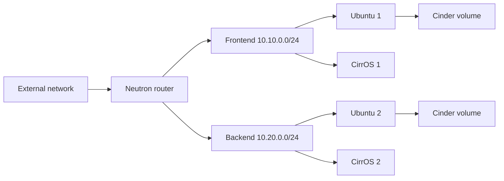

# OpenStack Heat Infrastructure

Heat Orchestration Template (HOT) for a small private-cloud lab. It creates a
two-network environment with compute, block storage, security groups, and
floating IPs using native OpenStack resources.

## Current status

The template parses as YAML and the repository documents its inputs and security
assumptions. No live OpenStack stack was created during the November 2026 audit,
so image names, flavors, quotas, and external-network access must still be
validated against the target cloud.

## Architecture



The template defines:

- two Neutron networks and subnets;
- one router attached to an external network;
- two Ubuntu and two CirrOS instances;
- two 10 GB Cinder volumes attached to the Ubuntu instances;
- one floating IP per instance;
- a shared security group for SSH, HTTP, HTTPS, MySQL, and ICMP.

## Repository

- [`template.txt`](template.txt): Heat template;
- `.gitattributes`: repository text settings.

## Prerequisites

- an OpenStack project with Heat, Nova, Neutron, and Cinder;
- OpenStack CLI credentials loaded in the shell;
- an existing SSH key pair;
- images, flavors, and an external network matching the selected parameters.

## Deploy

Review the parameters before creating a stack:

```bash
openstack stack create \
  --template template.txt \
  --parameter key_name=my-existing-key \
  my-stack
```

Inspect the stack and its outputs:

```bash
openstack stack show my-stack
openstack stack output list my-stack
```

Delete the lab stack when it is no longer needed:

```bash
openstack stack delete --yes --wait my-stack
```

## Security notes

Password-based SSH is disabled; instances require the supplied OpenStack key
pair. The lab template assigns floating IPs and currently permits several ports
from `0.0.0.0/0`, including MySQL. Restrict these rules to trusted CIDRs and
remove unneeded ports before using the template outside an isolated lab.

A password hash existed in earlier Git history. Removing it from the current
template does not revoke credentials on previously created VMs. Review or rebuild
those instances if that historical value was ever deployed.

## Validation

Static YAML parsing:

```bash
python -c "import pathlib, yaml; yaml.safe_load(pathlib.Path('template.txt').read_text())"
```

When connected to the target cloud, also run Heat validation:

```bash
openstack orchestration template validate \
  --template template.txt \
  --parameter key_name=my-existing-key
```

OpenStack-side validation remains environment dependent.
